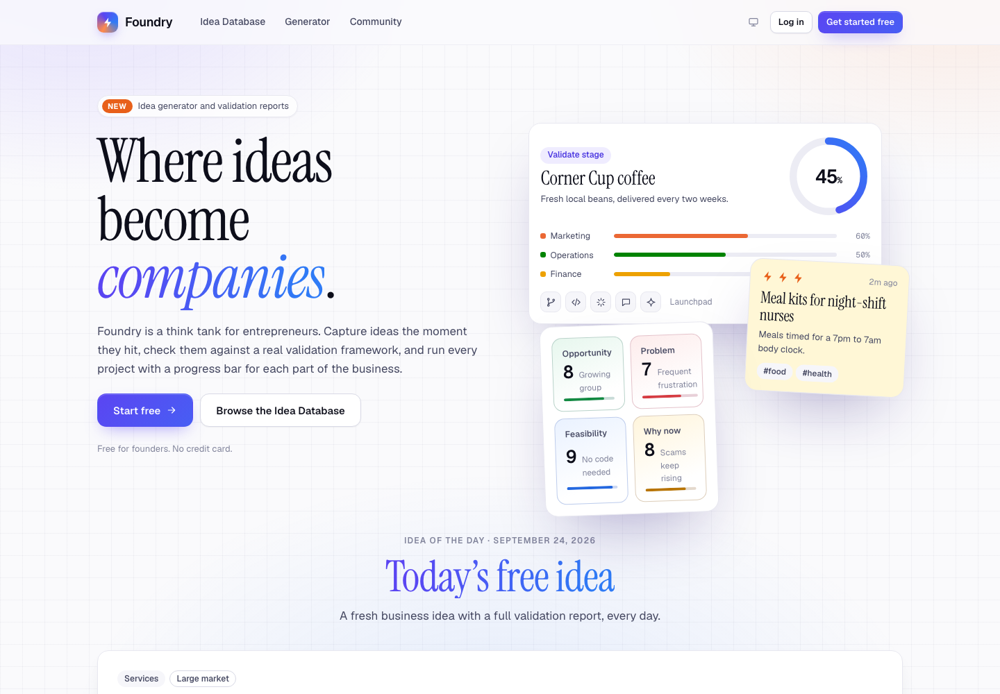
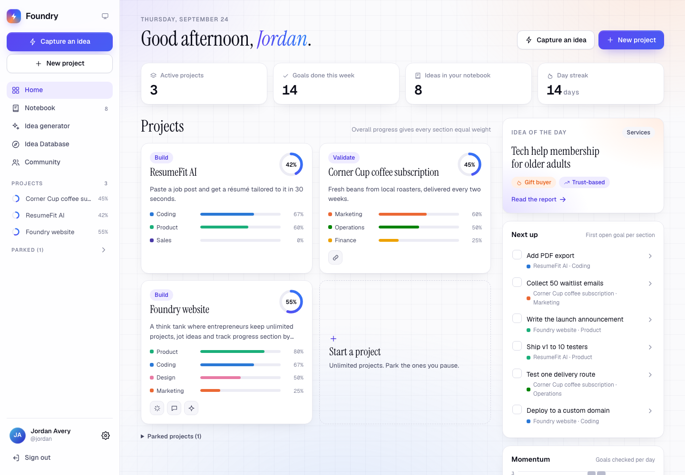
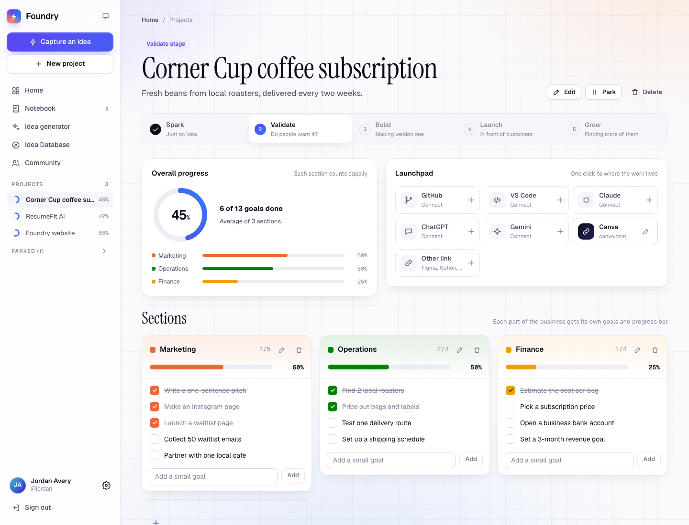
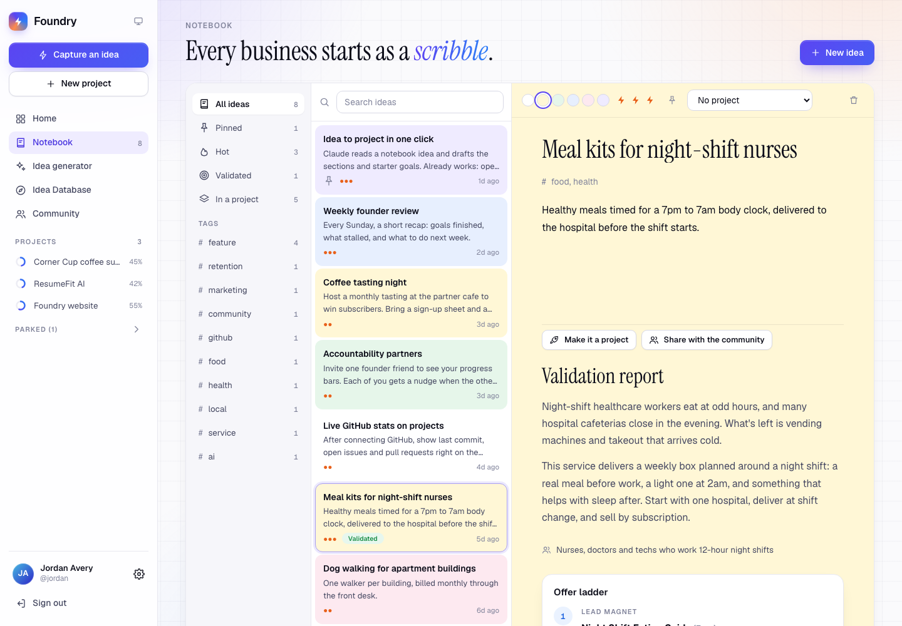
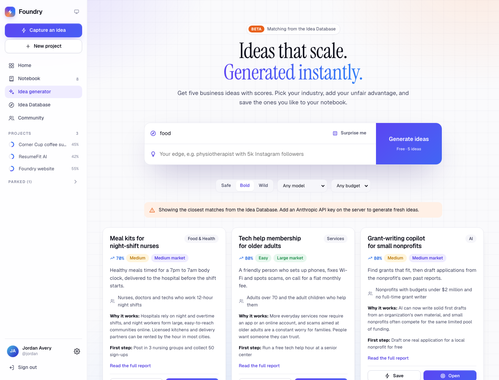
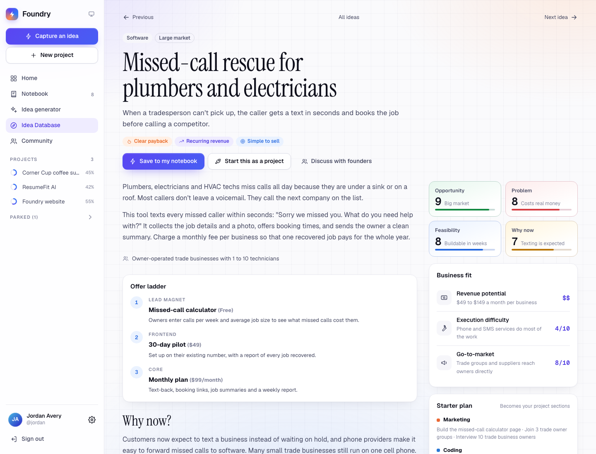
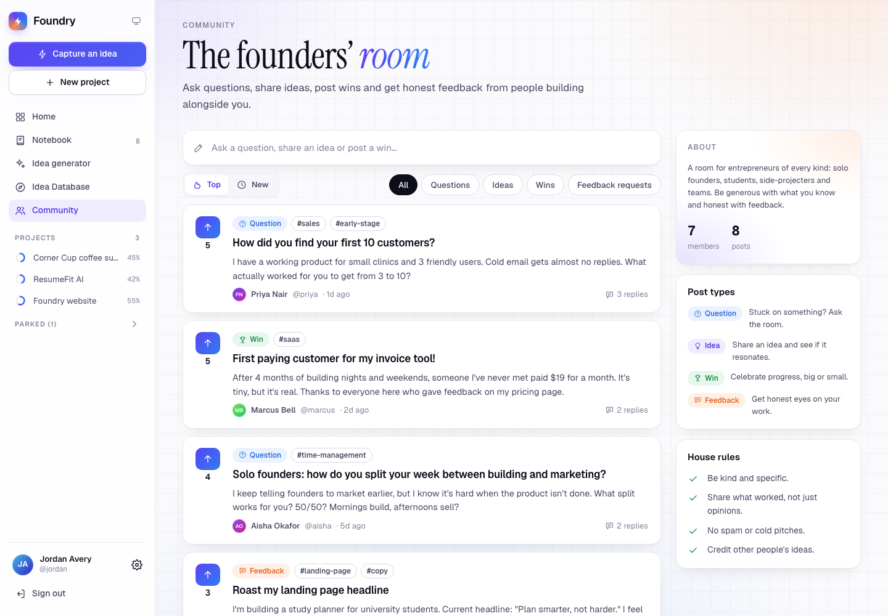

# Foundry

A think tank for entrepreneurs. Capture ideas, validate them, and run each project with a progress bar for every part of the business.



| Dashboard | Project | Notebook |
| --- | --- | --- |
|  |  |  |
| **Idea generator** | **Idea report** | **Community** |
|  |  |  |

## What's inside

- **Accounts**: sign up with email and password, or with GitHub when it's configured.
- **Home dashboard**: active projects with progress rings, a "Next up" goal list, a 14-day momentum chart, a day streak, the idea of the day and recent community posts.
- **Projects** (unlimited):
  - Sections such as Coding, Marketing, Product, Finance, Design, Operations, Sales, Legal, or your own. Each has goals and its own progress bar.
  - Overall progress is the average of the sections, so every section counts equally. Sections with no goals are left out until they get one.
  - Stages: Spark, Validate, Build, Launch, Grow. Park a project to pause it.
  - **Launchpad**: one-click links to GitHub, VS Code, Claude, ChatGPT, Gemini and any other tool. With GitHub connected you can pick a repository from a list, and the project also gets links to its issues, pull requests, github.dev and vscode.dev.
- **Notebook**: a three-pane idea notebook with colors, a 1-3 "spark" rating, tags, pins, search, autosave, links to projects, and "Make it a project".
- **Validation reports**: scores for opportunity, problem, feasibility and timing, plus business fit, an offer ladder, why now, risks, the cheapest tests to run, and a starter plan that becomes project sections.
- **Idea generator**: an industry plus your edge gives five scored ideas. It uses Claude when an API key is set, and matches from the Idea Database when it isn't.
- **Idea Database**: hand-written ideas with full reports, and an idea of the day.
- **Community**: questions, ideas, wins and feedback requests, with upvotes and replies.
- Light and dark themes, phone-friendly layouts.

## Open Foundry

**Double-click `Open Foundry.command`** in this folder. It starts Foundry and opens it at http://localhost:3000. The first time, it installs everything and creates a database with demo data, which takes a minute or two. Keep the Terminal window it opens running while you use Foundry, and close the window to stop it.

The first time you open it, macOS may say the file is from an unidentified developer. If so, right-click the file, choose **Open**, then choose **Open** again. You only need to do this once.

You need Node.js 20 or newer, from https://nodejs.org.

## Run it from the terminal

This does the same thing as the launcher, by hand.

```bash
npm install
npm run setup      # creates the SQLite database and loads demo data
npm run dev        # http://localhost:3000
```

On the login page, **Try the demo account** signs you in as `demo@foundry.local` (password `foundry-demo`). The demo login only works in development and only when `DEV_DEMO_LOGIN=1`.

The seed also creates five sample community members. It's for local development only, so don't run it against a production database.

## Going live and the iPhone app

- **`docs/DEPLOY.md`** puts Foundry online (Neon database and Vercel hosting, about 30 minutes).
- **`docs/IPHONE.md`** walks from installing Xcode to submitting to the App Store.
- **`docs/app-store/`** holds the App Store listing text, the privacy answers, the review notes and the screenshots.

Inside the iPhone app, Foundry uses a bottom tab bar, haptic feedback, a daily reminder, an in-app browser for outside links and an offline screen. The community has reporting, blocking, a word filter and a moderation page for people listed in `ADMIN_EMAILS`. Anyone can delete their account in Settings.

## Settings (`.env`)

| Variable | Needed | What it does |
| --- | --- | --- |
| `DATABASE_URL` | yes | `file:./dev.db` locally. A Postgres URL in production. |
| `AUTH_SECRET` | yes | A long random string. Encrypts stored GitHub tokens. |
| `APP_URL` | yes | The public URL, used for the GitHub callback. |
| `ANTHROPIC_API_KEY` | optional | Turns on the AI generator, validation reports, goal suggestions and plan drafting. |
| `FOUNDRY_AI_MODEL` | optional | Defaults to `claude-opus-5`. |
| `GITHUB_CLIENT_ID` / `GITHUB_CLIENT_SECRET` | optional | Turns on "Continue with GitHub" and the repository picker. |
| `DEV_DEMO_LOGIN` | dev only | `1` shows the demo login button. |
| `SUPPORT_EMAIL` | yes, before launch | Shown on the Support, Terms and Privacy pages. |
| `ADMIN_EMAILS` | yes, before launch | Comma-separated emails of moderators who can review reports. |

**GitHub sign-in**: create an OAuth app at https://github.com/settings/developers with the callback URL `<APP_URL>/api/auth/github/callback`. Foundry asks for `read:user` and `user:email`, so the repo picker lists public repositories. Private repositories would need a GitHub App.

**AI**: requests use structured JSON output. On `claude-opus-5`, server-side refusal fallbacks are turned on so a declined request is retried on a fallback model automatically. Each user gets 20 AI calls per hour.

## Going to production

1. In `prisma/schema.prisma`, change `provider = "sqlite"` to `"postgresql"`. Point `DATABASE_URL` at a hosted Postgres database such as Neon, Supabase or Railway, then run `npx prisma db push`.
2. Deploy to a Node host such as Vercel, Railway, Render or Fly. Set the variables above and leave `DEV_DEMO_LOGIN` unset.
3. Set `APP_URL` to your domain and update the GitHub OAuth callback URL to match.
4. Rate limits live in memory, so they reset on restart and aren't shared between instances. When you run more than one instance, move them to Redis or the database.

## Checks and tools

With the app running (`npm run dev`):

| Command | What it does |
| --- | --- |
| `npm run test:e2e` | Drives a real headless Chrome through sign-up, projects, goals, the Launchpad, the notebook, the Idea Database, the generator and the community, checking each step against the database. The test account is deleted afterwards. |
| `npm run screenshots` | Refreshes the images in `docs/screenshots`. Uses the demo account. |
| `npm run typecheck` | Type-checks the code. |
| `npm run licenses` | Regenerates `THIRD_PARTY_LICENSES.md` after packages change. |
| `npm run screenshots:app-store` | Retakes the six App Store screenshots at iPhone 6.9" size. |
| `npm run ios:sync` | Updates the iPhone project. Set `FOUNDRY_APP_URL=https://your-domain` for App Store builds. |
| `npm run ios:open` | Opens the iPhone project in Xcode. |
| `npm run build:production` | Builds for a hosted Postgres database (Vercel runs this automatically). |

The browser scripts need Google Chrome and the `sqlite3` command-line tool, which macOS includes. Set `CHROME_PATH` if Chrome is installed somewhere else.

## License

Foundry's own code is proprietary, with all rights reserved (see `LICENSE`). The open-source packages and fonts it uses keep their own licenses, which are listed with their full texts in `THIRD_PARTY_LICENSES.md`. All of them are compatible with a private, commercial product.

## Project layout

```
Open Foundry.command      double-click to start Foundry at http://localhost:3000
LICENSE                   Foundry's license
THIRD_PARTY_LICENSES.md   licenses of every open-source package and font the app ships with
docs/DEPLOY.md            how to put Foundry online
docs/IPHONE.md            how to build and submit the iPhone app
docs/app-store/           App Store listing, privacy answers, review notes and screenshots
docs/screenshots/         screenshots of the app
ios/                      the iPhone app (Xcode project)
mobile/                   the iPhone app's icon, launch screen and offline screen
capacitor.config.ts       iPhone app settings: bundle ID, which address it loads
prototype/                the first clickable prototype (the claude.ai version) as one file you can open directly
scripts/                  browser test, screenshot and license tools
prisma/schema.prisma      data model (users, sessions, projects, sections, goals, links, ideas, posts, comments, votes)
prisma/seed.mts           demo data for local development
src/app/                  pages: landing, auth, /app (dashboard, notebook, generator, projects, settings), explore, community
src/app/api/              GitHub sign-in, GitHub repos, dev demo login
src/actions/              server actions; every change checks that the signed-in user owns the data
src/components/           UI; project/ holds the project page, sections and Launchpad
src/lib/                  auth and sessions, Claude calls, GitHub, the Idea Database, progress math
src/app/globals.css       the design system (tokens for light and dark, components)
```

## Ideas for next

- Password reset and email verification, which need an email provider
- Due dates and a "This week" view
- A weekly founder review email
- Public project pages to build in public, plus accountability partners
- Live GitHub stats (last commit, open issues) on project pages
- Project templates (online store, SaaS, YouTube channel, local service)
- Drag to reorder sections and goals
- A mobile app
